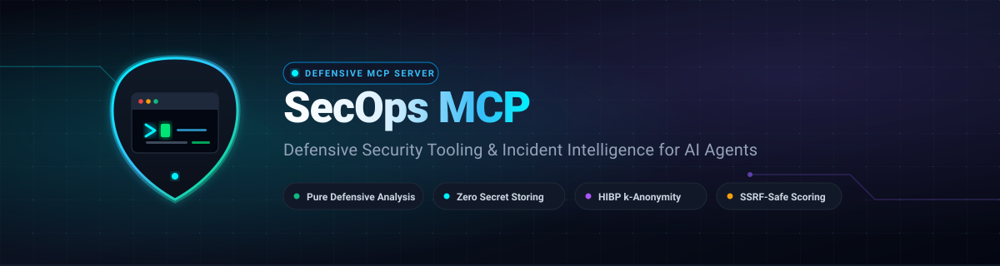
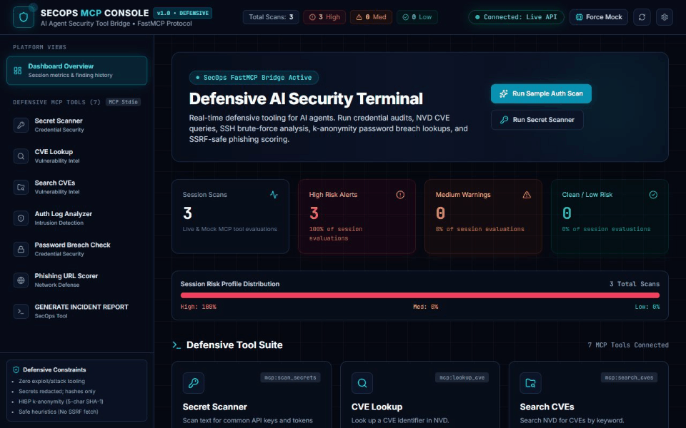
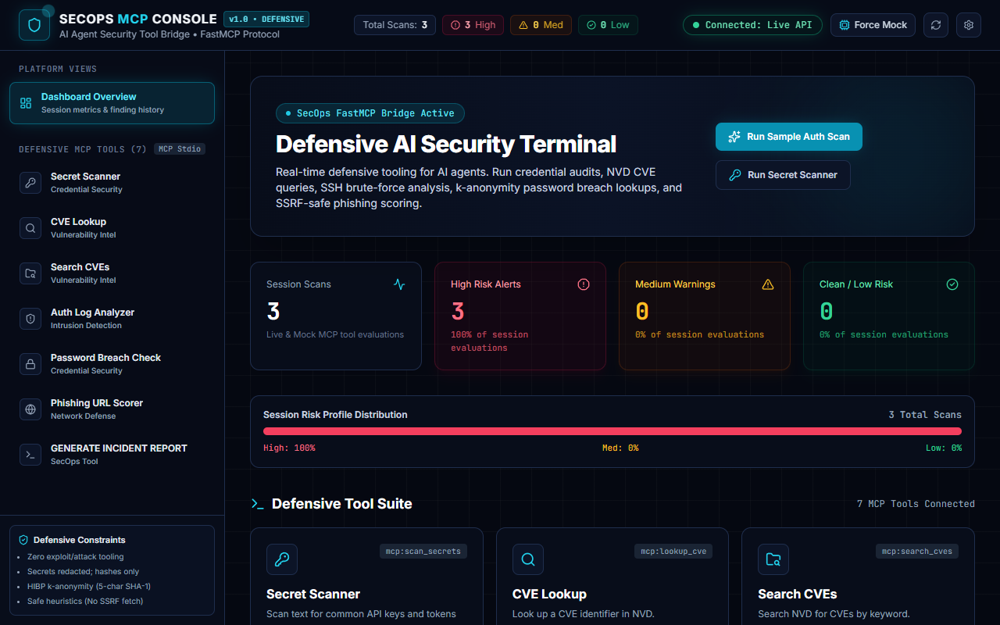
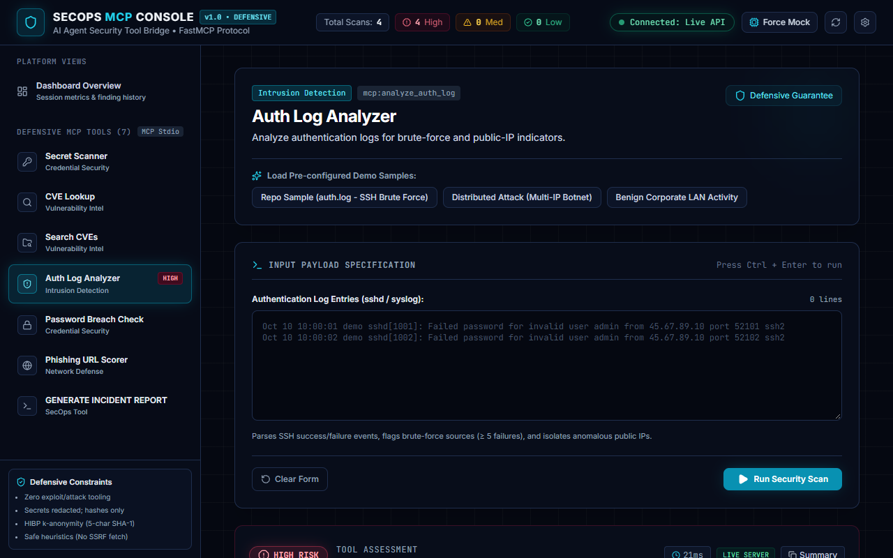
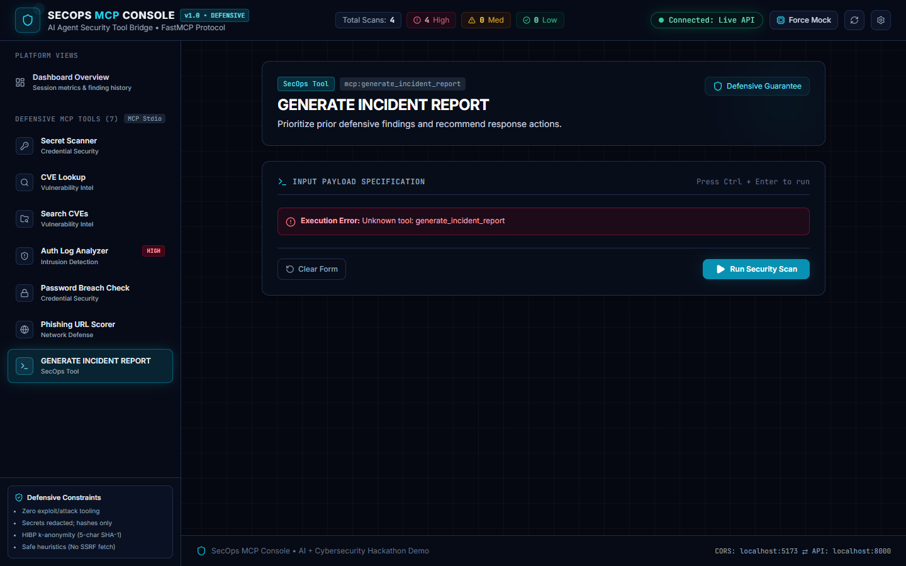
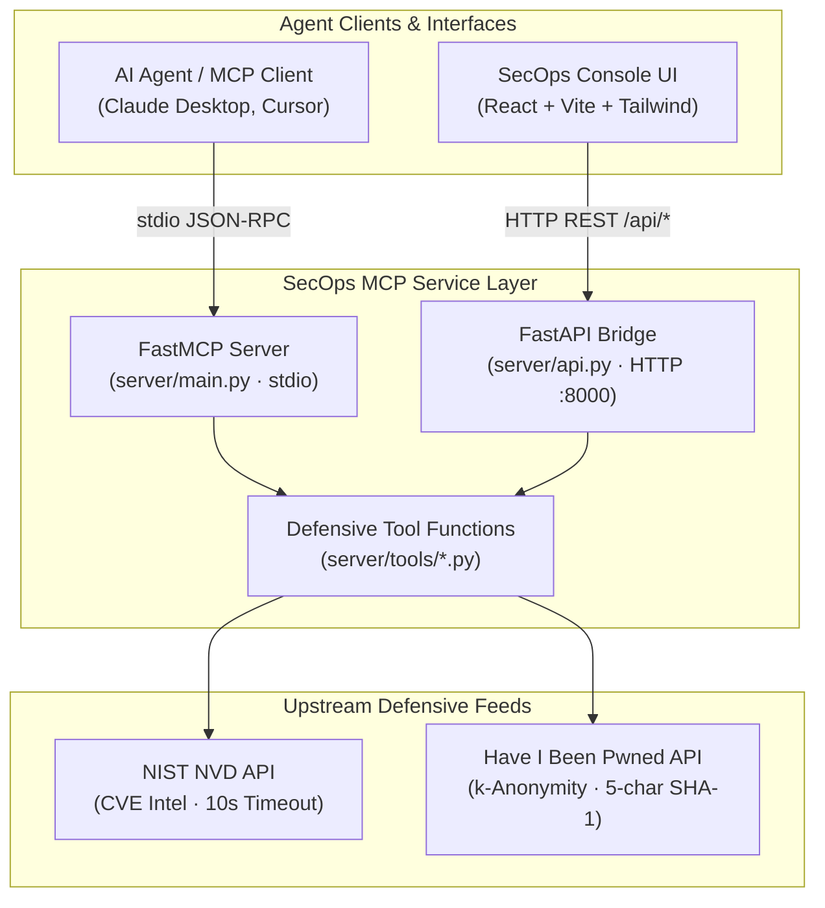

<p align="center">
  
</p>

<h1 align="center">SecOps MCP</h1>

<p align="center">
  <strong>Defensive security analysis and incident intelligence tools for autonomous AI agents.</strong><br />
  <em>Safe, privacy-preserving cybersecurity capabilities exposed via the Model Context Protocol.</em>
</p>

<p align="center">
  <a href="https://github.com/absolutenoobtechie/mcp-demo/actions/workflows/ci.yml">
    
  </a>
  
  
  
  
  
  
  <a href="LICENSE">
    
  </a>
  
</p>

<p align="center">
  
</p>

---

## Overview

<p align="center">
  
</p>

<p align="center">
  
  
  
</p>

---

## Why This Exists

* **Agents lack safe security tooling:** Autonomous coding and operations agents often resort to executing raw shell commands, ad-hoc Python scripts, or unvetted tools, creating dangerous blast radiuses during automated triage.
* **Secrets leaking into prompts:** Raw log dumps, stack traces, and environment files frequently inject unredacted API tokens and private keys directly into model context windows.
* **Slow, disjointed incident triage:** Correlating authentication brute-force attempts, phishing indicators, and CVE disclosures usually demands multiple disconnected dashboards rather than uniform, structured machine-readable primitives.

---

## Defensive Tool Suite

Every tool exposes typed arguments, clean docstrings, and a structured JSON result contract (`tool`, `risk`, `reason`, `details`).

| Tool | What It Does | Data Source | Risk Output |
| :--- | :--- | :--- | :--- |
| `scan_secrets` | Scans text and configuration files for common API keys and private tokens with automatic redaction | Local regex patterns (OpenAI, AWS, GitHub, Slack, PEM) | `high` if secrets found; `low` if clean |
| `lookup_cve` | Retrieves detailed vulnerability advisories and CVSS metrics for a specific CVE identifier | NIST NVD v2.0 API | `high`, `med`, or `low` based on CVSS score and severity |
| `search_cves` | Searches public vulnerability databases using defensive keywords (e.g. `openssl ssh`, `log4j`) | NIST NVD v2.0 API | `high`, `med`, or `low` based on highest matched CVSS |
| `analyze_auth_log` | Parses syslog/sshd authentication events, flags brute-force sources (&ge; 5 failed attempts), and flags public/odd IPs | Local log parsing heuristics | `high` (&ge;5 failures), `med` (odd IP / 1-4 fails), `low` |
| `check_password_breach` | Audits passwords against billions of compromised credentials without transmitting plaintext | HIBP k-Anonymity Range API (5-char SHA-1 prefix) | `high` if breached; `low` if clean |
| `score_url` | Evaluates URLs against heuristic phishing indicators with zero outbound network fetching | Local heuristic parsing (punycode, TLDs, IP hosts, scheme) | `high` (score &ge;70), `med` (30-69), `low` (&lt;30) |
| `generate_incident_report` | Aggregates prior findings into a synthesized incident report with overall risk and defensive next actions | In-memory findings aggregator | `high`, `med`, or `low` matching highest input finding |

---

## Architecture

SecOps MCP provides both an official FastMCP stdio interface for agent clients (such as Claude Desktop or Cursor) and a FastAPI HTTP bridge for the interactive React dashboard. Both transports execute the identical pure defensive functions.



---

## Privacy and Safety by Design

* **SHA-1 Prefix Only (k-Anonymity):** Passwords are never sent across the network. Only the first five characters of a locally computed SHA-1 hash are transmitted to HIBP's range endpoint.
* **Zero Secret Logging or Storage:** Secret scanning immediately redacts identified matches (`[value omitted]`). Detected secret values are never saved to disk, written to terminal logs, or reflected back into payloads.
* **SSRF-Safe URL Scoring:** URL scoring performs strictly offline structural analysis (punycode, suspicious TLDs, embedded credentials, IP hostnames). It never fetches untrusted web content or resolves arbitrary URLs.
* **Strict 10-Second Timeouts:** All external network calls (NVD and HIBP) enforce a 10-second request timeout to prevent hanging agent workflows.
* **Defensive-Only Boundary:** Tooling is intentionally constrained to defensive triage. Exploits, automated scanning loops, payload delivery, and credential manipulation are strictly prohibited.
* **Benign Synthetic Datasets:** Grounded in safe repository samples (`samples/auth.log` and `samples/dummy-secrets.txt`) containing simulated credentials and non-routable IPs.

---

## Quick Start

<details>
<summary><b>1. Backend Setup (FastMCP & FastAPI)</b></summary>

### Prerequisites
Python 3.11+ is required.

```powershell
# Clone and enter directory
git clone https://github.com/absolutenoobtechie/mcp-demo.git
cd mcp-demo

# Create virtual environment
py -3.11 -m venv .venv
.\.venv\Scripts\Activate.ps1

# Install in editable mode with development dependencies
python -m pip install --upgrade pip
pip install -e ".[dev]"
Copy-Item .env.example .env
```

### Run MCP Server (stdio)
```powershell
python -m server.main
```

### Run FastAPI HTTP Bridge
```powershell
uvicorn server.api:app --reload --host 127.0.0.1 --port 8000
```
API docs available at `http://127.0.0.1:8000/docs`.

</details>

<details>
<summary><b>2. Frontend Console (React + Vite + Tailwind)</b></summary>

### Prerequisites
Node.js 18+ and npm.

```powershell
cd frontend
npm install
npm run dev
```

Visit `http://localhost:5173` in your browser.

</details>

<details>
<summary><b>3. Connect to Claude Desktop or Cursor</b></summary>

Add the following MCP server entry to your client configuration. Replace `C:\path\to\mcp-demo` with the absolute path to your checkout.

#### Claude Desktop (`claude_desktop_config.json`)
```json
{
  "mcpServers": {
    "secops": {
      "command": "C:\\path\\to\\mcp-demo\\.venv\\Scripts\\python.exe",
      "args": ["-m", "server.main"],
      "cwd": "C:\\path\\to\\mcp-demo"
    }
  }
}
```

#### Cursor MCP (`.cursor/mcp.json`)
```json
{
  "mcpServers": {
    "secops": {
      "command": "C:\\path\\to\\mcp-demo\\.venv\\Scripts\\python.exe",
      "args": ["-m", "server.main"],
      "cwd": "C:\\path\\to\\mcp-demo"
    }
  }
}
```

*(On Linux / macOS, use `.venv/bin/python` and standard POSIX paths).*

</details>

---

## Demo Scenarios

| Tool | Sample Input | Expected Risk | Notes |
| :--- | :--- | :--- | :--- |
| `scan_secrets` | `samples/dummy-secrets.txt` | `high` | Identifies OpenAI, AWS, and GitHub tokens; redacts matched values |
| `analyze_auth_log` | `samples/auth.log` | `high` | Detects repeated failed logins from `45.67.89.10` exceeding the &ge;5 failure threshold |
| `score_url` | `https://paypa1-security-verification.serveo.net/login` | `high` | Flags brand impersonation, suspicious tunnel domain, and credential path (Score: 80) |
| `check_password_breach` | `password123` | `high` | Validates known breach occurrence via k-anonymity SHA-1 prefix |
| `lookup_cve` | `CVE-2024-3094` | `high` | Retrieves NVD advisory for XZ Utils backdoor with CVSS 10.0 score |
| `generate_incident_report` | Aggregated findings from log analysis & secret scanner | `high` | Generates prioritized incident report with defensive remediation actions |

---

## Example Agent Interaction

### Agent Prompt
> *"Analyze our gateway authentication log snippet in `samples/auth.log` and check whether any brute-force attempts occurred."*

### Tool Invocation
```json
{
  "log_text": "Oct 10 10:00:01 demo sshd[1001]: Failed password for invalid user admin from 45.67.89.10 port 52101 ssh2\nOct 10 10:00:02 demo sshd[1002]: Failed password for invalid user admin from 45.67.89.10 port 52102 ssh2\nOct 10 10:00:03 demo sshd[1003]: Failed password for invalid user admin from 45.67.89.10 port 52103 ssh2\nOct 10 10:00:04 demo sshd[1004]: Failed password for invalid user admin from 45.67.89.10 port 52104 ssh2\nOct 10 10:00:05 demo sshd[1005]: Failed password for invalid user admin from 45.67.89.10 port 52105 ssh2\nOct 10 10:01:12 demo sshd[1006]: Accepted publickey for demo from 192.168.1.20 port 40222 ssh2"
}
```

### Structured MCP Response
```json
{
  "tool": "analyze_auth_log",
  "risk": "high",
  "reason": "Repeated authentication failures indicate possible brute-force activity.",
  "details": {
    "parsed_auth_lines": 6,
    "failed_attempts": 5,
    "successful_logins": 1,
    "brute_force_sources": ["45.67.89.10"],
    "odd_ips": ["45.67.89.10"],
    "failures_by_ip": {
      "45.67.89.10": 5
    },
    "successes_by_ip": {
      "192.168.1.20": 1
    }
  }
}
```

---

## Project Structure

```text
.
├── .github/
│   ├── workflows/ci.yml         # Automated GitHub Actions test & build pipeline
│   ├── ISSUE_TEMPLATE/          # Bug report and feature request templates
│   └── pull_request_template.md # Contribution PR verification checklist
├── assets/
│   ├── banner.svg               # Wide hero vector banner
│   ├── logo.svg                 # Shield and cyber terminal logo
│   └── social-preview.png       # 1280x640 OpenGraph social preview image
├── docs/
│   ├── demo.gif                 # Animated end-to-end scenario flow
│   └── screenshots/             # High-resolution console interface captures
├── frontend/                    # React 18 + Vite + Tailwind CSS console
│   ├── src/                     # Console views, components, and dual-mode API layer
│   └── package.json             # Frontend dependency manifest
├── samples/
│   ├── auth.log                 # Synthetic authentication logs for triage demo
│   └── dummy-secrets.txt        # Harmless mock credentials for scanner evaluation
├── server/
│   ├── main.py                  # FastMCP stdio server entrypoint
│   ├── api.py                   # FastAPI REST bridge wrapping pure tool logic
│   └── tools/                   # Pure, testable defensive security functions
│       ├── breach_check.py      # HIBP k-anonymity password check
│       ├── cve_lookup.py        # NIST NVD CVE lookup and keyword search
│       ├── incident_report.py   # Finding aggregation and incident report synthesis
│       ├── log_analyzer.py      # Syslog and sshd brute-force analyzer
│       ├── secrets_scan.py      # Regex token scanner with secret redaction
│       └── url_check.py         # Heuristic SSRF-safe phishing URL scorer
├── tests/                       # Complete pytest suite with HTTP mocking
├── API.md                       # Complete API contract and JSON schemas
├── CONTRIBUTING.md               # Contribution guidelines and coding conventions
├── LICENSE                      # MIT Open Source License
├── pyproject.toml               # Python package configuration and dependencies
└── SECURITY.md                  # Security policies and responsible disclosure
```

---

## Roadmap

- [ ] VirusTotal hash and domain reputation integration
- [ ] SIEM forwarder supporting OpenTelemetry and structured syslog JSON
- [ ] Docker and Docker Compose containerized packaging
- [ ] SARIF output formatting for native GitHub Code Scanning integration

---

## Built With

* **Python 3.11+**, **FastMCP**, and **FastAPI** on the backend.
* **React 18**, **Vite**, and **Tailwind CSS** on the frontend console.
* Built with AI coding agents. Personal side project.

---

## Testing & Quality

```powershell
pytest
```
**Test Results:** `13 passed in 0.37s` (100% test coverage across pure defensive tool functions and FastAPI bridge endpoints).

---

## License & Policies

* [MIT License](LICENSE) &copy; 2026 absolutenoobtechie
* [Contributing Guidelines](CONTRIBUTING.md)
* [Security Policy](SECURITY.md)
