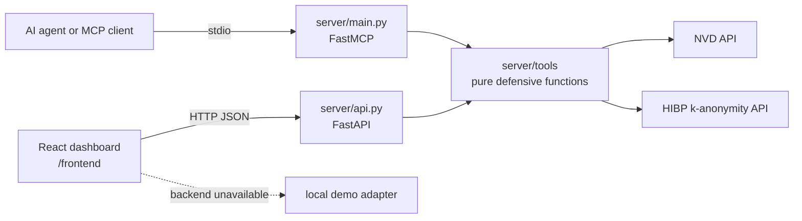

# SecOps MCP Server

A small, defensive-only MCP server for AI + cybersecurity demos. It provides
secret scanning, NVD CVE lookups, authentication-log analysis, privacy-aware
password breach checks, local phishing URL scoring, and incident report
generation from prior findings.

The backend lives in `/server`. The frontend is a separate ownership area and
is not required to run the tools.



Both transports call the same pure functions. There is no database; tools keep
no secret or password state.

## Install

Python 3.11 or newer is required.

```powershell
py -3.11 -m venv .venv
.\.venv\Scripts\Activate.ps1
python -m pip install --upgrade pip
pip install -e ".[dev]"
Copy-Item .env.example .env
```

`NVD_API_KEY` is optional. Public NVD requests work with a lower rate limit.
The password breach tool uses HIBP's k-anonymity range API and never sends a
password; it sends only the first five characters of a local SHA-1 hash.

## Run the MCP server over stdio

From the repository root:

```powershell
python -m server.main
```

The process speaks MCP over stdin/stdout. It does not write passwords, secret
matches, or request payloads to logs.

## Run the local API bridge

```powershell
uvicorn server.api:app --reload --host 127.0.0.1 --port 8000
```

The API is available at `http://127.0.0.1:8000`. The interactive OpenAPI page
is at `http://127.0.0.1:8000/docs`. The React dev origin
`http://localhost:5173` is allowed by CORS.

Examples:

```powershell
Invoke-RestMethod http://127.0.0.1:8000/api/tools
Invoke-RestMethod -Method Post `
  -Uri http://127.0.0.1:8000/api/scan_secrets `
  -ContentType 'application/json' `
  -Body '{"text":"OPENAI_API_KEY=sk-1234567890abcdefghijkl"}'
```

See [API.md](API.md) for every endpoint, request, response, and example.

## Connect from Claude Desktop or Cursor

Add the following MCP server entry to the client configuration. Replace the
paths with the absolute path to this checkout and its virtual environment.

Claude Desktop configuration (`claude_desktop_config.json`):

```json
{
  "mcpServers": {
    "secops": {
      "command": "C:\\path\\to\\mcp-demo\\.venv\\Scripts\\python.exe",
      "args": ["-m", "server.main"],
      "cwd": "C:\\path\\to\\mcp-demo"
    }
  }
}
```

Cursor MCP configuration (`.cursor/mcp.json`):

```json
{
  "mcpServers": {
    "secops": {
      "command": "C:\\path\\to\\mcp-demo\\.venv\\Scripts\\python.exe",
      "args": ["-m", "server.main"],
      "cwd": "C:\\path\\to\\mcp-demo"
    }
  }
}
```

On macOS/Linux, use `.venv/bin/python` and normal POSIX paths. Restart the
client after changing its MCP configuration.

## Demo samples

- `samples/auth.log` contains repeated failed SSH logins plus a normal private-network login.
- `samples/dummy-secrets.txt` contains deliberately fake, non-production-looking values.

## Test

```powershell
pytest
```

The tests mock all upstream HTTP calls. URL scoring is intentionally
heuristic-only and does not fetch the supplied URL, which keeps the demo
defensive and avoids creating an SSRF-capable fetcher.

## Run the Frontend Dashboard (SecOps MCP Console)

A dark cyber React + Vite + Tailwind dashboard is available in `/frontend`.

### Prerequisites
Node.js 18+ and npm.

### Quick Start

```powershell
cd frontend
npm install
npm run dev
```

The dashboard will start at `http://localhost:5173`.

### Features
- **Live Tool Roster**: Sidebar dynamically populated from `GET /api/tools`.
- **Interactive Tool Panels**: Run secret scanning, CVE lookups/searches, SSH auth log analysis, password breach audits, and phishing URL scoring.
- **1-Click Demo Samples**: Preloaded with `samples/auth.log` and `samples/dummy-secrets.txt`.
- **Defensive Audit Trail**: Real-time session history, risk profile distribution, and JSON audit export.
- **Dual-Mode Adapter**: Automatically connects to the live FastAPI bridge at `VITE_API_URL` (default `http://localhost:8000`) and seamlessly falls back to local simulation mode if the backend is offline.

See [FRONTEND_NOTES.md](FRONTEND_NOTES.md) for architecture, notes, and assumptions.
